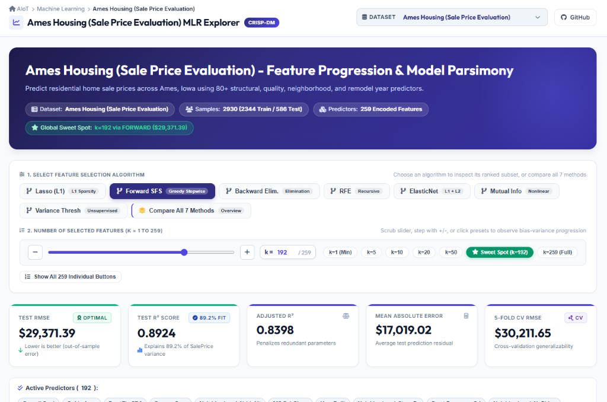

# Multiple Linear Regression & Feature Selection Explorer (MLR)

[](https://jiwawa1006.github.io/MLR/)
[](https://python.org)
[](https://en.wikipedia.org/wiki/Cross-industry_standard_process_for_data_mining)

> 🌐 **Live Demo Website**: **[https://jiwawa1006.github.io/MLR/](https://jiwawa1006.github.io/MLR/)**

An interactive, publication-quality web dashboard for Multiple Linear Regression and Feature Selection evaluation, deployed on **GitHub Pages**.

Supports interactive model diagnostics, parsimony analysis (Occam's razor), bias-variance tradeoff exploration, and dynamic dataset selection via a dropdown menu.

---

## 📸 Live Dashboard Preview



---

## 🌟 Key Features

1. **Dynamic Dataset Dropdown (下拉選單)**:
   - Seamlessly switch between 9 diverse machine learning datasets:
     - **Ames Housing** (High-Dimensional Real Estate Valuation with 80+ Features)
     - **Boston Housing** (Suburban Housing Valuation)
     - **US Cancer Mortality** (County-Level Health & Socioeconomic Analytics)
     - **Forest Cover Type** (USGS Wilderness Cartographic Attributes)
     - **E-Commerce Customer Behavior** (Customer Total Spend & Demographics)
     - **Automobile Pricing** (Vehicle Specifications & Price Valuation)
     - **50 Startups** (Commercial Profit Prediction)
     - **Student Performance** (Secondary Education Grade G3 Prediction)
     - **Wine Quality** (Physicochemical Sensory Quality Scoring)
   - Automatically adapts to any newly added datasets in `data/`.
2. **7 Feature Selection Algorithms**:
   - **Filter Methods**: Variance Threshold, Mutual Information
   - **Wrapper Methods**: Forward Stepwise Selection, Backward Elimination, Recursive Feature Elimination (RFE)
   - **Embedded Methods**: Lasso (L1 regularization), Elastic Net (L1 + L2)
   - **Compare All**: Overlay performance across all 7 algorithms simultaneously
3. **Interactive Dual k-Controls & Parsimony Navigation**:
   - Modern range slider, number stepper (`+`/`-`), and milestone preset chips (`★ Sweet Spot`, `k=1 Min`, `k=max Full Model`)
   - Interactive click-to-select directly on Chart.js curve points
4. **Interactive Visualizations (Chart.js)**:
   - Dynamic Train vs. Test RMSE curves with highlighted optimal parsimonious sweet spot $k^*$
   - Train vs. Test $R^2$ curves across all feature count steps
5. **Fitted OLS Regression Equation**:
   - Real-time formatted mathematical equation ($y = \beta_0 + \beta_1 X_1 + \dots$) with expandable term view for high-dimensional models
6. **Statistical Tests & Coefficients Table**:
   - Parameter estimates ($\beta$), Standard Errors, t-statistics, p-values, 95% Confidence Intervals, and significance stars
7. **Live Value Predictor & Reset**:
   - Interactive slider and numeric inputs dynamically built from active features to test predictions in real-time, with one-click "Reset Medians"
8. **Test Residual & Outlier Diagnostics**:
   - Out-of-sample sample ranking by absolute error $|y - \hat{y}|$ with diagnostic status dots

---

## 📁 Repository Structure

```
MLR/
├── assets/
│   └── dashboard_preview.png   # Live dashboard screenshot preview
├── index.html                  # Main dashboard HTML (GitHub Pages entrypoint)
├── index.css                   # Polished modern stylesheet
├── app.js                      # Interactive controller and Chart.js integration
├── model_data.js               # Precomputed statistics & metrics for all datasets
├── export_web_data.py          # Exporter that updates model_data.js from data/ and fig/
├── plot_figure.py              # Core experiment pipeline & Matplotlib figure generator
├── feature_selector.py         # Feature selection algorithms & CV routines
├── data/                       # CSV datasets
│   ├── startups_50.csv
│   ├── boston_housing.csv
│   ├── amse_housing.csv
│   ├── cancer_deathrate.csv
│   ├── cover_type.csv
│   ├── student_performance.csv
│   ├── automoblie.csv
│   ├── e-commerce_customer_behavior.csv
│   └── wine_quality.csv
├── fig/                        # Saved 300 DPI publication plots and metric CSVs
│   ├── startups_50/
│   ├── amse_housing/
│   ├── boston_housing/
│   ├── cancer_deathrate/
│   ├── cover_type/
│   ├── student_performance/
│   ├── automoblie/
│   ├── e-commerce_customer_behavior/
│   └── wine_quality/
└── requirements.txt            # Python dependencies
```

---

## 🚀 How to Run & Preview Locally

1. **Install dependencies**:
   ```bash
   pip install -r requirements.txt
   ```

2. **Run the experiments**:
   - **Run all datasets**:
     ```bash
     python plot_figure.py
     ```
   - **Run a single dataset**:
     ```bash
     python plot_figure.py data/wine_quality.csv
     # or simply by name:
     python plot_figure.py wine_quality
     ```
   - **Run multiple specific datasets**:
     ```bash
     python plot_figure.py data/automoblie.csv data/wine_quality.csv
     ```
   *This automatically runs feature selection, generates plots in `fig/`, and updates `model_data.js`.*

3. **Preview the web dashboard**:
   ```bash
   python -m http.server 8080
   ```
   Open your browser to [http://localhost:8080](http://localhost:8080).

---

## 🌐 Live GitHub Pages Deployment

The dashboard is automatically hosted on GitHub Pages:

👉 **[https://jiwawa1006.github.io/MLR/](https://jiwawa1006.github.io/MLR/)**

To deploy or update:
```bash
git add .
git commit -m "Update dashboard"
git push origin main
```
GitHub Pages automatically deploys from the `main` branch root `/`.

---

## ➕ How to Add New Datasets in the Future

1. Place your new CSV file in the `data/` folder (e.g. `data/my_new_data.csv`).
2. Run:
   ```bash
   python plot_figure.py
   ```
3. That's it! The script will automatically:
   - Identify or detect the target variable
   - Train and evaluate all 7 feature selection methods
   - Export plots and metrics
   - Append the new dataset into `model_data.js`
   - The frontend dropdown menu (**下拉選單**) will automatically list your new dataset!